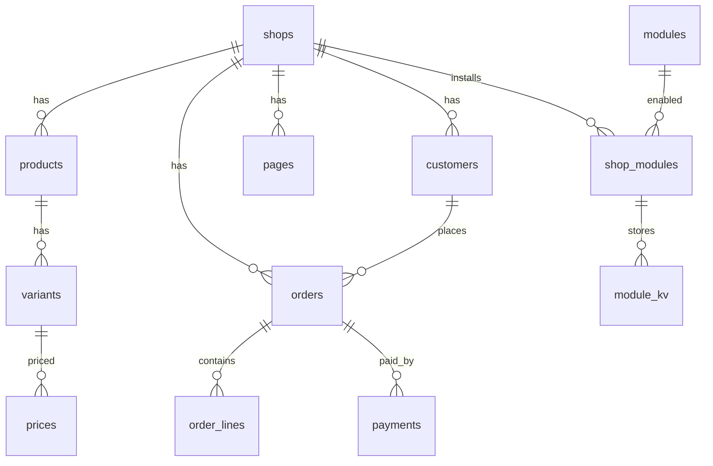

# Modèle de données EUROMNI

**Moteur : PostgreSQL 16+.** L’hébergeur n’est pas figé : n’importe quelle instance Postgres suffit. L’instance actuelle est chez IONOS (pas OVH). Le schéma est portable : UUID, `timestamptz`, `jsonb`, pas d’extensions propriétaires.

Un prototype SQLite séparé explore une installation légère mono-boutique pour le catalogue, le panier et le checkout. Il n’est ni compatible avec les migrations PostgreSQL, ni câblé au CMS, et ne change pas le moteur de référence. Son périmètre et ses limites sont décrits dans [`docs/sqlite-prototype.md`](sqlite-prototype.md).

Source de vérité : migrations SQL numérotées et registre `schema_migrations`.  
Schéma initial : [`migrations/0001_init.sql`](../migrations/0001_init.sql).  
Jeu exemple : [`migrations/0002_seed_example.sql`](../migrations/0002_seed_example.sql).  
Mapping Wasm : [`docs/abi.md`](abi.md).

## Choix

| Sujet | Décision |
|-------|----------|
| SGBD | PostgreSQL (SQL, transactions, JSONB, enums) |
| Identifiants | UUID v4 (`gen_random_uuid`) |
| Argent | `numeric(19,4)` + `char(3)` ISO 4217 — jamais de float |
| i18n | tables `*_translations` (locale, champs texte) |
| Multi-boutique | colonne `shop_id` partout ; une seule boutique = une ligne `shops` |
| Modules Wasm | config + KV scopés ; **pas** d’accès SQL depuis Wasm |
| Médias | URI (objet / CDN), pas de fichiers dans Postgres |
| Commandes | snapshot des lignes (sku, nom, prix) pour rester lisibles si le catalogue change |
| Paniers invités | Jeton Bearer aléatoire, hash SHA-256 stocké, expiration à 30 jours (`0003_cart_access_tokens.sql`) |

Les données de la base CMS locale résident dans un volume persistant. La base d’intégration utilise un projet Compose et un stockage temporaires séparés ; son nettoyage ne doit jamais viser le volume du CMS. Un volume local ne remplace pas des sauvegardes hors machine ni des tests de restauration.

JSONB est réservé à ce qui est vraiment variable : `settings`, `metadata`, options de variante, config module, payload d’événement, corps de page (blocs). Le reste est normalisé.

## Carte des tables



Groupes :

1. **Boutique / staff** — `shops`, `shop_locales`, `users`, `shop_members`, `sessions`
2. **Clients** — `customers`, `addresses`, `customer_consents`
3. **Catalogue** — `categories`, `products`, `variants`, `prices`, `inventory_items`, `media`
4. **Commerce** — `carts`, `orders`, `payments`, `shipments`
5. **CMS** — `pages`, `menus`
6. **Sandbox** — `modules`, `shop_modules`, `module_kv`, `domain_events`

## Accès

Seul le processus Go parle à Postgres. L’ABI Wasm (`catalog`, `cart`, `module.kv`, …) est la façade. Les modules n’ont pas de connection string.

## Appliquer les migrations

Les fichiers SQL versionnés sont la source importable du schéma. Pour initialiser une base PostgreSQL vierge, depuis la racine du dépôt avec `DATABASE_URL` configuré :

```bash
for migration in migrations/0001_init.sql migrations/0002_seed_example.sql migrations/0003_cart_access_tokens.sql migrations/0004_schema_migrations.sql migrations/0005_seed_second_product.sql migrations/0006_seed_representative_catalog.sql; do
  psql "$DATABASE_URL" -v ON_ERROR_STOP=1 -f "$migration" || exit 1
done
```

Appliquer ces scripts une seule fois et dans l’ordre ; `0004` crée `schema_migrations` et enregistre les versions initiales, puis `0005` et `0006` enregistrent les seeds catalogue. Sur une base existante, vérifier le ledger et sauvegarder les données avant toute nouvelle migration. Ne pas rejouer les scripts d’initialisation sur une base qui contient des données.

Ces migrations contiennent le schéma et le seed d’exemple, pas une sauvegarde des données clients ou des transactions. Les données doivent être sauvegardées séparément avec `pg_dump`, conservées hors machine et restaurées/testées séparément. Cette procédure opérationnelle reste à mettre en place avant tout usage client.
